## DevOps Diploma Project Netology YC
## Zhelonkin Dmitrii

#### О проекте

Проект создается в рамках обучения по курсу по направлению DevOps

Цель проекта - развернуть облачную инфраструктуру в YandexCloud, установить Kubernetes, настроить мониторинг и реализовать автоматизированные процессы CI/CD для тест приложения

В проекте был использован следующий стек: 
- Terraform - создание инфраструктуры. 
- Ansible + Kubespray для настройки и развертывания кластера Kubernetes. 
- Helm-chart Prometheus + grafana для мониторинга. 
- Jenkins для CI/CD.
- Nginx в качестве веб-сервера

[ССЫЛКА НА РЕПОЗИТОРИЙ С ПРИЛОЖЕНИЕМ](https://github.com/deadwhitepunk/nginx-demo-diploma/tree/main)

#### Архитектура проекта

Для реализации дипломного проекта была выбрана следующая архитектура:

| Компонент | Технология | 
|---|---|
| Cloud provider | Yandex Cloud |
| IaC | Terraform |
| IaC conf manager | Ansible| 
| Orchestration | Kubernetes с использованием KubeSpray |
| OS | Ubuntu 26.04 LTS |
| Container Registry | Docker hub |
| CI/CD | Jenkins |
| Monitoring | Helm-Chart Prometheus + Grafana |
| Terraform state | Yandex object Storage


#### Архитектурные решения

Конфигурация кластера Kubernetes:

| Узел | Кол-во | CPU | RAM | Disk |
|---|---|---|---|---|
|Control plane | 1 | 2 | 4 | 20 |
|Worker | 2 | 2 | 4 | 20 |

Control plane - 1

Worker node - 2

Установка и настройка Kubernetes будут выполняться с помощью Kubespray, управление конфигурацией через Ansible.

2. Сетевая инфраструктура

Была создана VPC в YC в нескольких зонах доступности

Зоны доступонсти:

- ru-central1-a
- ru-central1-d

Подсети:

- private-a - ipv4 CIDR 10.10.2.0/24
- public-a - ipv4 CIDR 10.10.1.0/24
- private-d - ipv4 CIDR 10.10.3.0/24

Public subnet - требуется для доступа Bastion

Private subnets - для изолирования кластера k8s

Так как у кластера k8s не должно быть внешнего IP, был создан NAT Gateway и route table для исходящего доступа приватных узлов в интернет.

Все значения переменных находятся в файле terraform.tfvars, но он не будет опубликован из-за чувствительной информации. Переменные находятся в variables.tf

Файл настройки сети находится ниже:

[Network.tf](https://github.com/deadwhitepunk/devops-diploma/blob/main/terraform/infrastructure/network.tf)

Для сетевой безопасности были созданы Security groups для каждой группы хостов, а именно:

- bastion_sg - сетевые настройки безопасности для бастион хоста (Jump-host)
- control_plane_sg - сетевые настройки безопасности для контрол ноды
- workers_sg - сетевые настройки безопасности для worker ноды
- alb_sg - сетевые настройки безопасности для Application Load Balancer

Файл Security Groups находится ниже:

[security_groups.tf](https://github.com/deadwhitepunk/devops-diploma/blob/main/terraform/infrastructure/security_groups.tf)

Bastion-host используется ТОЛЬКО для доступа администратора к инфраструктуре.

Для этого у него есть публичный адрес, подключение к внутренним хостам осуществляется через SSH ProxyJump

Пример ~/.ssh/config

```sh
Host bastion-jump
  Hostname 51.X.X.X
  User ubuntu
Host control-plane-01
  HostName 10.10.2.X
  User ubuntu
  ProxyJump bastion-jump
```

Проверяем:

`ssh control-plane-01`

```sh
 System information as of Thu Nov 12 06:14:18 UTC 2026

  System load:  0.09               Processes:             106
  Usage of /:   13.4% of 18.75GB   Users logged in:       0
  Memory usage: 6%                 IPv4 address for eth0: 10.10.2.X
  Swap usage:   0%

ubuntu@control-plane-01:~$
```

3. Terraform

Terraform будет использоваться для автоматического создания облачной инфраструктуры.

Создаваемые ресурсы:

- VPC и подсети в разных зонах доступности.
- Security Groups.
- Виртуальные машины Control Plane и Worker Nodes.
- Bastion Host.
- Отдельная VM Jenkins
- DNS зона и DNS записи для хостов

Создаваемые DNS-записи:

- jenkins.systemerase.site
- grafana.systemerase.site
- app.systemerase.site

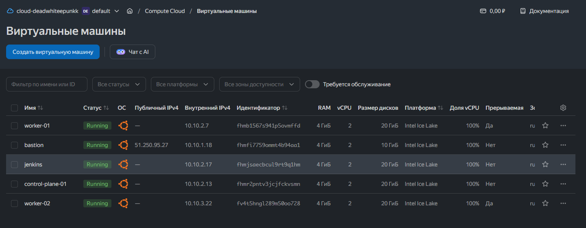

Необходимые сетевые компоненты.

Для повторного использования конфигурации будет разработан универсальный Terraform-модуль виртуальной машины.

Для управления состоянием Terraform планируется использовать Yandex Object Storage (Remote Backend).

Для повторного использования и поддержания концепции DRY (Dont repeat yourself) был создан модуль vm-module

Иерахрия vm-module:

main.tf - основной код для создания VM
outputs.tf - какие данные нам надо передавать
variables.tf - переменные
provider.tf - провайдер YC

Далее в методе main.tf уже в основном проекте мы можем вызывать этот модуль сколько хотим

Пример вызова модуля на основе control-plane-01:

```tf
module "control_planes" {
  source             = "./modules/vm-module"
  for_each           = var.control_planes
  name               = each.key
  hostname           = each.key
  disk_size          = each.value.disk_size
  platform_id        = var.platform_id
  zone               = each.value.zone
  ram                = each.value.ram
  cpu                = each.value.cpu
  subnet_id          = yandex_vpc_subnet.subnets[each.value.subnet_id].id
  ssh_public_key     = var.ssh_public_key
  image_id           = var.image_id
  public_ip          = false
  preemptible        = false
  security_group_ids = toset([yandex_vpc_security_group.control_plane_sg.id])
}
```


4. Ansible

Для настройки Kubernetes используется Ansible и Kubespray.

Terraform отвечает за создание виртуальных машин и сетевой инфраструктуры, а Ansible и Kubespray — за установку и настройку Kubernetes.

В результате развёрнут Kubernetes-кластер со следующей конфигурацией:

- 1 Control Plane.

- 2 Worker Nodes.

Kubernetes version: v1.37.1.

Список node

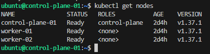

Администрирование узлов осуществляется через Bastion Host.

inventory.ini создается и наполняется прямо в terraform

Наполнение inventory:

```sh
resource "local_file" "inventory" {
  content  = <<-XYZ
[kube_control_plane]
${module.control_planes["control-plane-01"].hostname} ansible_host=${module.control_planes["control-plane-01"].private_ip} ip=${module.control_planes["control-plane-01"].private_ip} etcd_member_name=etcd1

[etcd:children]
kube_control_plane

[kube_node]
${module.workers["worker-01"].hostname} ansible_host=${module.workers["worker-01"].private_ip} ip=${module.workers["worker-01"].private_ip}
${module.workers["worker-02"].hostname} ansible_host=${module.workers["worker-02"].private_ip} ip=${module.workers["worker-02"].private_ip}

[all:vars]
ansible_user=ubuntu
ansible_ssh_private_key_file=~/.ssh/id_ed25519
ansible_python_interpreter=/usr/bin/python3

ansible_ssh_common_args='-o ProxyJump=ubuntu@${module.bastion.public_ip} -o StrictHostKeyChecking=no -o UserKnownHostsFile=/dev/null'
XYZ
  filename = "../../ansible/kubespray/inventory/mycluster/inventory.ini"
}
```

Запуск playbook

```sh
resource "terraform_data" "ansible_config" {
  triggers_replace = [
    sha256(local_file.inventory.content)
  ]

  depends_on = [
    module.bastion,
    module.workers,
    module.control_planes,
    local_file.inventory
  ]

  provisioner "local-exec" {
    working_dir = "/home/sadmin/netology-hw/diploma/ansible/kubespray"

    command = "ansible-playbook -i inventory/mycluster/inventory.ini -b -v cluster.yml"
  }
}
```
5. Kubernetes

В k8s создан отдельный namespace "diploma"

```yaml
apiVersion: v1
kind: Namespace
metadata:
  name: diploma
  labels:
    environment: development
```

В нем располагается приложение (статичная страничка) на базе nginx

Deployment настроен на запуск трех реплик приложения

[Deployment.yaml](https://github.com/deadwhitepunk/devops-diploma/blob/main/k8s/deployment.yaml)

Для публикации приложения используется Service типа NodePort

NodePort: 31235
Domain: app.systemerase.site

[service.yaml](https://github.com/deadwhitepunk/devops-diploma/blob/main/k8s/service.yaml)

Обновление приложения выполняется через Jenkins

Состояние подов:


6. Yandex Application Load Balancer

Для того что бы наши сервисы были доступны снаружи используется Yandex Application Load Balancer. Он в нашем случае выполняет маршрутизацию http-запросов на основе DNS имени и направляет трафик уже по определенным backend группам.

Создаем target group где будут серверы принимающие входящий трафик. Для Grafana и нашего приложения используются в качестве целевых узлов Workers ноды. 
Далее Backend Group она связывается с таргет Group с необходимыми портами.

Порты:

| Домен | Backend Group | Порт назначения |
|---|---|---|
| app.systemerase.site | app-backend | 31235 |
| grafana.systemerase.site | grafana-backend | 31000 |
| jenkins.systemerase.site | jenkins-backend | 8080 |

На последнем этапе создаём HTTP Listener, который принимает входящие HTTP-запросы на порту 80 и передаёт их HTTP Router для дальнейшей маршрутизации.

В результате ALB становится единой внешней точкой входа для приложения, системы мониторинга и CI/CD-сервера Jenkins. Это позволяет обращаться к сервисам по отдельным DNS-именам, используя один балансировщик нагрузки.

ALB в YC

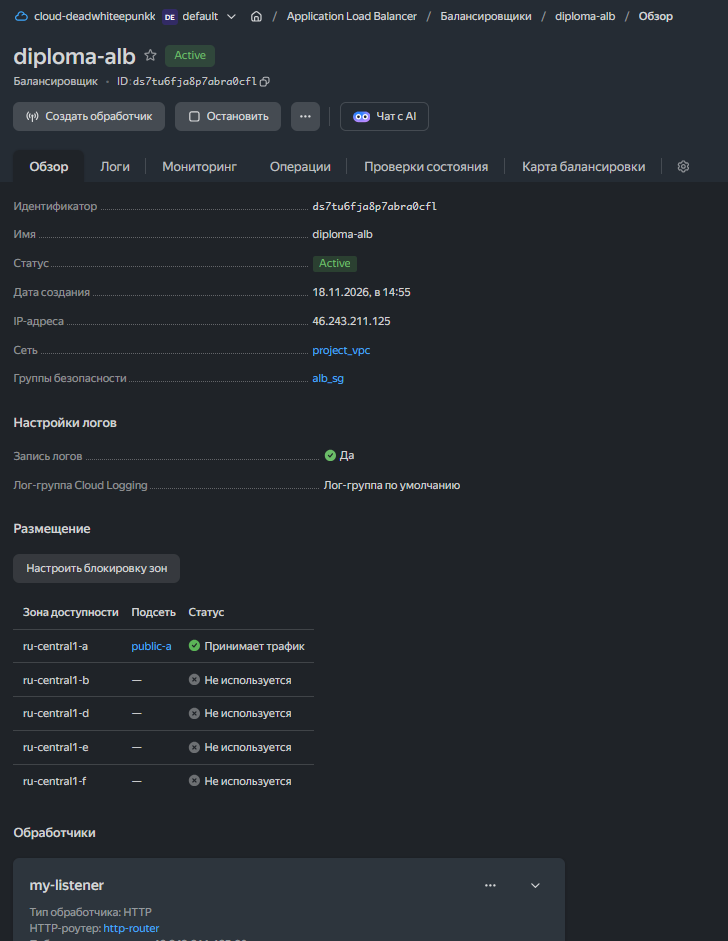

7. Container Registry

Для хранения Docker образов используется Docker hub.

Репозиторий: zhelonkindd/nginx-demo

[Ссылка на Docker image](https://hub.docker.com/r/zhelonkindd/nginx-demo/tags)

В репозитории находится

- Dockerfile - сборка docker image
- index.html - сама веб-страница
- Jenkinsfile - описание pipeline jenkins

В Docker Hub публикуются образы с тегами, соответствующими номеру сборки Jenkins или Git-тегу.

8. CI/CD на базе Jenkins

Для реализации CI/CD мною был выбран Jenkins. Благодаря plugin и большому комьюнити данный выбор пал именно на этот продукт

Он находится на отдельной виртуальной машине и доступен по адресу: http://jenkins.systemerase.site

Был создан отдельный kubeconfig + установлен plugin Kubernetes CLI Plugin

Для аутентификации в Docker Hub и Kubernetes используются Credentials в Jenkins с предварительно созданными токенами в двух этих системах

Создание токена в kubernetes для jenkins 

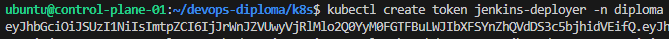

2 credential: Docker and Kubernetes


Репозиторий приложения:

https://github.com/deadwhitepunk/nginx-demo-diploma

Pipeline находится в Jenkinsfile в данном репозитоии

[Jenkinsfile](https://github.com/deadwhitepunk/nginx-demo-diploma/blob/main/Jenkinsfile)

9. Как работает CI/CD?

Есть 2 сценария.

Первый сценарий - пуш без тэга, обычный коммит в main

При появлении комита в ветке main Jenkins получает репозиторий из Github, проверяет в нем наличие необходимых файлов (Dockerfile и index.html - обязательно) и собирает Docker image и пулит его в DockerHub с тэгом номера сборки в pipeline

Второй сценарий - пуш с тэгом

При публикации git тэга например v1.0.0 Jenkins сканит репозиторий каждые 10 минут, в случае если есть новый тэг он получает код коммита, проверяет файлы, собирает Docker image с тэгом, публикует в DockerHub и тут уже подключается Kubernetes, обновляется образ контейнера в deployments nginx-test и проверяет успешность обновления с помощью `kubectl rollout status`

При первом сценарии образ будет называться `zhelonkindd/nginx-demo:5`

При втором сценарии `zhelonkindd/nginx-demo:v1.0.0` и будет задеплойен в Kubernetes

Результаты выполнения:

Выкатываем версию v2.0.1

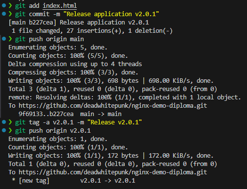

После скана pipeline видит пуш сначала в main и выполняет pipeline и пропускает Deploy to Kubernetes

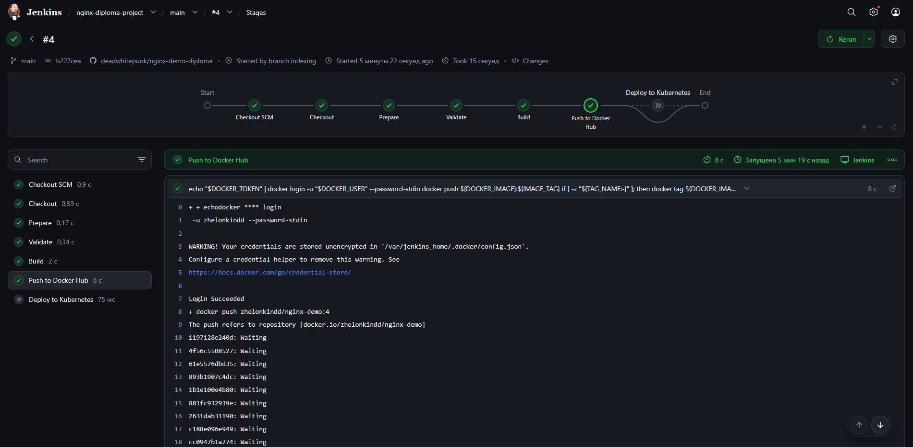

Pipeline сразу видит что мы еще применили tag v2.0.1 и запускает pipeline для тэгов с Deploy to Kubernetes

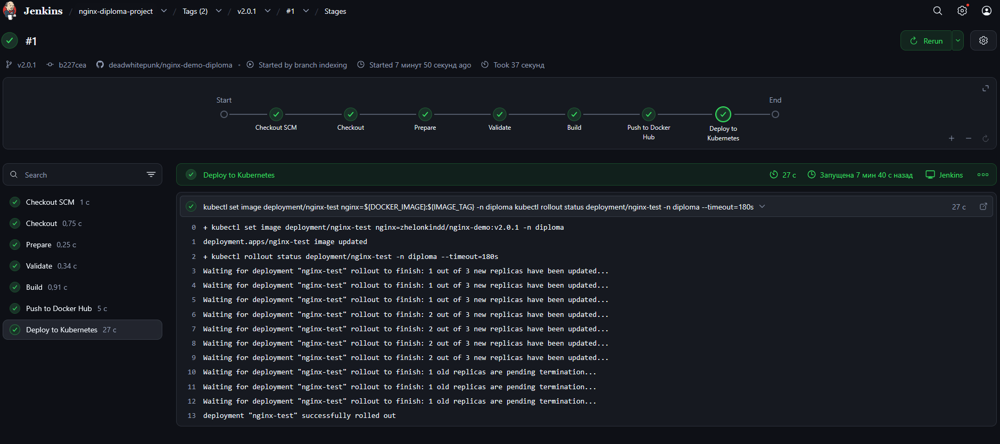

По логам видим что он задеплоил. Нужно проверить версию image в Kubernetes

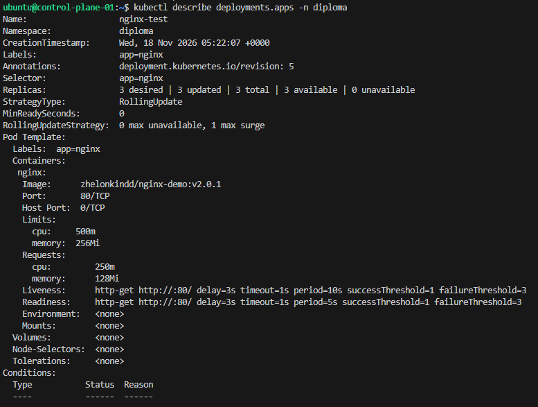

Посмотрим что у нас на веб странице `http://app.systemerase.site`

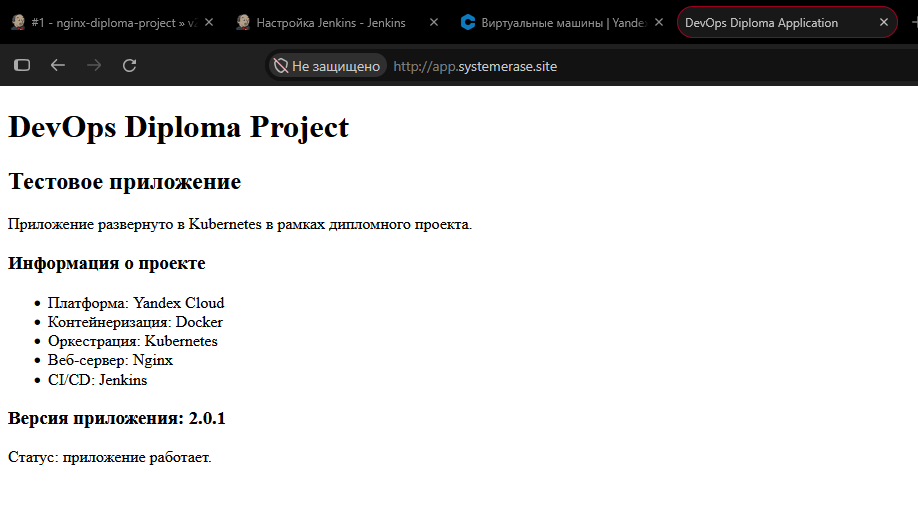

Успех!

Проверим docker image на DockerHub

Есть и с тэгом номера сборки и с тэгом нашего приложения которое мы применили врунчную

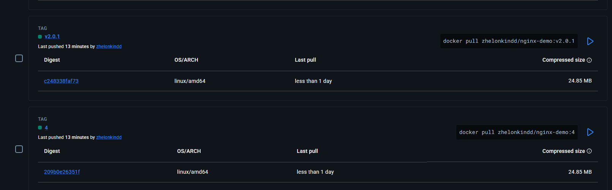

10. Мониторинг

Для проверки состояния и нагруженности кластера используется стек:

- Prometheus - хранение метрик
- Node Exporter — сбор системных метрик Kubernetes
- Grafana - визуализация метрик, дашборды
- Alertmanager - отправка оповещений об алертах

Стек реализован в отдельный namespace "monitoring" и задеплоен с помощью Helm-charts.

URL Grafana: http://grafana.systemerase.site

Все дашборды:

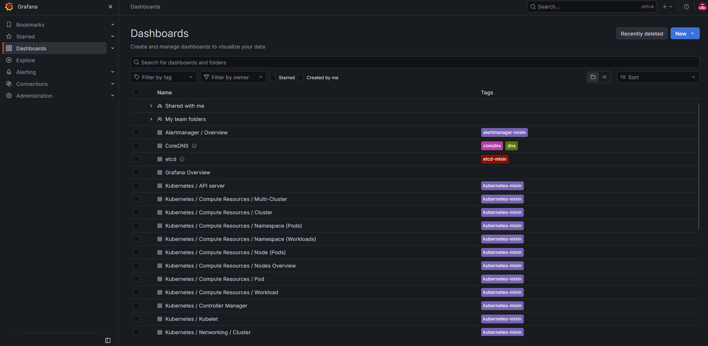

Дашборд для просмотра состояния кластера Kubernetes

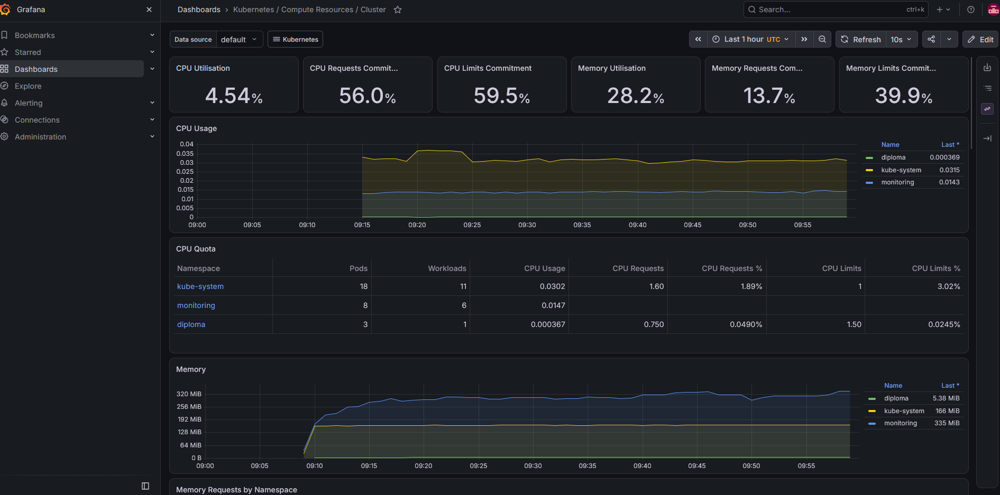

11. Итоги проекта

В рамках моего дипломного проекта была разработана и развернута облачная инфарструктуа в Yandex Cloud с использованием принципа IaC Terraform.

Развернут кластер Kubernetes 1 control plane и 2 worker nodes. Ко всем неиспользуемым портам был закрыт доступ с помощью security groups. Надежное подключение через bastion host, кластер из интернета не торчит. Создана автоматическая конфигурация kubespray который запускается с помощью terraform.

В Kubernetes размещено Nginx приложение с 3мя репликами.

Реализован CI/CD Pipeline на базе Jenkins и DockerHub. Проверена автоматическая сборка Dockerfile при изменениях в Git и автоматическая публикация и развёртывание новой версии приложения в Kubernetes при создании Git-тега.

В результате получена инфраструктура, позволяющая автоматизировать создание облачных ресурсов, управление Kubernetes-кластером, мониторинг и доставку новых версий приложения.